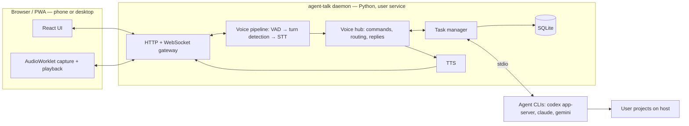

# Agent Talk — High-Level Design

Status: draft for review. Date: 2026-10-23.

The Rust/Docker prototype is preserved on the `archive/rust-prototype` branch. This
document describes the Python rewrite.

## 1. Goal and principles

Talk to your coding agents. Speak a request; an agent (Codex, Claude Code, Gemini CLI)
works on your own computer; Agent Talk asks you for approvals and reads you the
results, in a version the agent writes to be heard.

- **Self-hosted FOSS.** Each user installs and runs their own copy. It is not a hosted service.
- **Subscriptions, not API keys.** Agents run through the official CLIs under the user's
  existing login. Agent Talk never holds provider credentials or calls provider APIs itself.
- **Local except the agents.** Speech recognition and speech synthesis run on the
  user's machine. The only cloud traffic is what the official agent CLIs send to their
  providers.
- **Don't spend the user's agent usage on chat.** Only real tasks reach the agent. The
  one thing asked of it beyond the task is a short spoken version of a long reply (§6.3).
- **Explicit routing.** The user picks the target, by selecting it or naming the project
  first. No model guesses where a request should go (§6.3).
- **Runs on the host.** The daemon is a user-level system service, so agents act on the
  user's real repositories, toolchains and credentials. The agents' own sandbox and
  permission modes are the safety boundary, plus Agent Talk's approval policy.
- **One install.** `uv tool install agent-talk && agent-talk setup`. No Docker, Node,
  Ollama or compiler required.
- **Configurable to the hardware.** Works CPU-only, and makes stronger models easy to
  choose when a GPU or Apple Silicon is available.

Scope for v1: Linux and macOS, English only, push-to-talk, phone and desktop browsers
over HTTPS (Tailscale recommended, any reverse proxy works). Deferred: wake word, open-mic conversation sessions (designed for, see
§6.5), Windows, native mobile apps, other languages.

## 2. Architecture



| Area | Choice | Notes |
| --- | --- | --- |
| Backend | Python 3.12+, asyncio, FastAPI/Starlette, uvicorn | Single process. Inference runs in worker threads or processes, never on the event loop. |
| Frontend | React + TypeScript + Vite, shadcn/ui (Radix + Tailwind), PWA | Largest contributor pool and component ecosystem. The prototype's UI is the visual reference. The built assets ship inside the Python wheel. |
| Storage | SQLite (WAL) + `config.toml` | Data under XDG data dir on Linux, `~/Library/Application Support/agent-talk` on macOS. |
| Speech models | ONNX Runtime (CPU / CUDA / CoreML execution providers); onnx-asr for Parakeet, kokoro-onnx for Kokoro | Installed from pip; no system packages. Our own pipeline code, not Pipecat (§6). |
| Remote access | Tailscale (`tailscale serve`) recommended, or any HTTPS reverse proxy | Provides HTTPS. Daemon itself binds loopback only; who may use it is decided by device pairing (§8), not by the transport. |
| Service | systemd `--user` unit / launchd LaunchAgent | Installed by `agent-talk service install`. Runs as the user. |

## 3. Core concepts

- **Project.** A registered directory with a name, optional spoken aliases (e.g.
  "backend", "api"), a default agent with its model and effort, and an approval policy.
  Added via UI or
  `agent-talk project add ~/code/api --name backend --alias api`.
- **Task.** One unit of agent work: project + agent + agent session/thread + status,
  with an optional model and effort that override the project's. Tasks are long-lived;
  follow-ups to the same work go to the same task, so the agent keeps its context.
  Status: `queued → running ↔ awaiting_approval → completed | failed | cancelled |
  unknown`, and `background` when the turn is over but the agent's work goes on (§4.1).
- **Event.** Normalized agent output: text, command started/finished, file changed,
  plan update, approval request, completion. Events are stored per task (bounded)
  and fan out to clients and the voice hub.

## 4. Agent integration

### 4.1 Adapter contract

The contract is in `src/agent_talk/agents/base.py`. An adapter provides `status()`
(installed, logged in), `capabilities`, and `open(cwd, resume_token, policy, on_event,
on_approval)`, which returns a session with `send(text)`, `interrupt()` and `close()`.
Capabilities declare what the CLI really supports (interruption, resume, live
approvals, which approval modes and access levels, work that outlives a turn, a
project configuration to opt into, and whether the model changes between turns); unsupported behaviour is shown in the UI, not
faked. Without interrupt, cancelling stops the process; without resume, a new process
starts a new conversation.

Adapters translate everything into the contract's own vocabularies, and nothing
outside an adapter sees a provider's words:

| | Values |
| --- | --- |
| Events | `message_delta`, `message`, `command_started`, `command_finished`, `file_change`, `plan`, `error`, `turn_started`, `turn_completed`, `background` |
| Turn status | `completed`, `cancelled`, `failed` |
| Turn started by | `user`, `agent` |
| Command and file change status | `running`, `completed`, `failed`, `declined` |
| File change kind | `add`, `delete`, `update`, `move` |
| Plan step status | `pending`, `active`, `done` |
| Approval mode | `ask`, `auto`, `never` (§4.4) |
| Access level | `read-only`, `workspace` (edit the project directory), `full` |
| Approval request | `command` (the command as typed, unwrapped, and whether it only reads), `edit` (paths and changes), `tool` (any other tool, by name, with a short input), `access` (network or paths beyond the access level) |

Approval requests carry only those fields, an optional `title` (the agent's own
description) and an `extra` dict of provider detail that is shown raw and never
interpreted. The engine, not the adapter, writes the summary, classifies the risk and
decides whether "always" can apply (a command prefix, all edits, or one tool by name).

An agent with `background_turns` may leave work running when its turn ends
(`background` lists it, and is sent empty when it is done) and start a turn itself to
report it (`turn_started` with `by: "agent"`). The task is `background` meanwhile:
follow-ups run as usual, the process isn't closed for idleness, and cancelling stops
it, which ends the work. The agent's own turn runs like any other, messages queued
during it go after it, and its reply is spoken on the task's owner after the approval
chime. Background work doesn't survive a restart.

Each adapter lists its models and their reasoning efforts (`models()`). A project sets
a default model and effort, a task may override them, and a change applies from the
task's next turn: between turns for an agent with `live_model_change`, otherwise by
reopening the session on the same conversation.

Adapters whose CLI calls back into Agent Talk (Claude Code's permission prompts) use
the daemon's MCP endpoint, `/mcp/<secret>`: one secret per session, local requests
only, never browsers (`agents/callbacks.py`).

The last `message` of a turn is its answer, and is what gets spoken. The resume token
is opaque: a Codex thread id, a Claude Code session id or an ACP session id.
`check_event` validates events against the contract, and the conformance tests run
every adapter's events through it.

Processes are spawned with argument arrays, controlled environments and the project
directory as working directory. Transcripts are never interpolated into shell strings.
Terminal screen scraping is not used.

### 4.2 Providers

| Provider | Interface | Status |
| --- | --- | --- |
| Codex | `codex app-server` (JSON-RPC over stdio): threads, turns, item events, approval requests, interrupt | First adapter. Protocol already exercised by the prototype. |
| Claude Code | The user's installed `claude` CLI in headless mode (`-p`, stream-json input/output, `--session-id`/`--resume`), with approvals routed through a permission-prompt tool served by the daemon | Second adapter (M4, [m4-agents.md](m4-agents.md)). Runs the unmodified `claude` on the user's own login, never the Agent SDK or `--bare`, and never touches its credentials; the terms reading is in the M4 doc. Access is enforced with permission modes and path-scoped rules, since its bash sandbox needs nested user namespaces. A project's own hooks and MCP servers load only when the project opts in. |
| Gemini CLI | ACP mode over stdio | Evaluate session, approval and cancel behavior against a pinned version. |

ACP adapters exist for Codex and Claude Code too. If they prove reliable, ACP could
become the single adapter path. Decide after the Codex adapter works natively.

### 4.3 Concurrency

- Many tasks may run at once, each with its own agent process/session.
- Default: one running task per project. Additional tasks for the same project queue,
  to avoid two agents editing one working tree. Configurable; git worktrees are a later option.
- Global limit on concurrent agent processes (configurable, default 3).
- Shared local inference (STT, TTS) is one instance each, with priority
  STT > TTS. Agent processes are never blocked by speech work.

### 4.4 Approvals

Approval requests from any task go through one policy engine:

| Setting | Behavior |
| --- | --- |
| `ask` | Ask by voice and show a card on screen; either may answer. Codex: `approvalPolicy = untrusted`. |
| `auto` | The agent works freely within its access level and asks only to go beyond it. Codex: `on-request`. |
| `allow-always` rules | Remembered decisions, e.g. "always allow `npm test` in backend". Created by saying "approve always" / tapping "Always". Scoped to project + command prefix or tool/file pattern. Viewable and revocable in Settings. |
| `never` | Full auto. Maps to the agent's own non-interactive mode (e.g. Codex `approval_policy = never`). Anything beyond the access level fails. Clearly marked in UI. |

Policy is set globally, then per project, then per agent. Each request is classified
as read / edit / execute / network / destructive (`rm`, `git push`, force flags…, and
edits that delete files).
A per-class setting can raise the bar, e.g. destructive actions require repeating a
confirmation phrase even when edits are approved by plain "yes".

Voice approval is a fixed flow, not free chat. Agent Talk plays a short chime as the
approval appears instead of reading it out; the card shows the task and the action.
Only a clear
yes/no/always is accepted; anything else re-prompts. Pending approvals never time out
into approval. Every decision, and who/what made it, is logged.

## 5. Local models

### 5.1 Model catalog and hardware tiers

A curated catalog (shipped with the app, updatable) lists tested models per role
(STT, VAD, turn detection, TTS). Each entry has a download URL, SHA-256,
size, RAM/VRAM need, license, and tier.

`agent-talk setup` detects CPU, RAM and accelerator (CUDA, Vulkan, Metal) and proposes
a tier. Settings shows the catalog with "fits your machine" hints. Changing a model
downloads it in the background and switches when ready.

Speech defaults (validated by the M0 spike, see
[spikes/speech](../spikes/speech/README.md)):

| Role | CPU tier | GPU tier | License |
| --- | --- | --- | --- |
| VAD | Silero VAD v6.2 | same (runs on CPU) | MIT |
| Turn detection | smart-turn v3.2 (CPU build) | smart-turn v3.2 (GPU build) | BSD-2-Clause |
| STT | Parakeet TDT 0.6B v2 (English), int8 | Parakeet TDT 0.6B v2, fp32 | CC-BY-4.0 |
| TTS | Kokoro-82M v1.0, int8 (Piper for very low-end) | Kokoro-82M v1.0, fp32 | Apache-2.0 (Kokoro); GPL-3 espeak-ng phonemizer |

Runtime settings from M0:

- **CPU inference uses a small fixed thread count** (default 4 per model). Using all
  cores was 2–4× slower on a hybrid P/E-core CPU. Configurable.
- **int8 on CPU, fp32 on GPU.** int8 Parakeet loses no accuracy (2.9% WER either way)
  but is slow under CUDA.
- **CUDA sessions use `cudnn_conv_algo_search=HEURISTIC`.** The default exhaustive
  search re-tunes for every new input length, and live captions produce one per tick.
- The GPU tier uses about 4.5 GB of VRAM (models, cuDNN workspace and a 60 s final
  pass); setup recommends it when 5 GB is free.
- Apple Silicon (CoreML) and low-end CPU tiers still need measuring.

Reference results (i7-12650H, RTX 4060 Laptop):

| | GPU | CPU, 4 threads |
| --- | --- | --- |
| Caption update period | 250 ms (decode ~80 ms) | 250 ms p50, ~450 ms p95 |
| Final transcript, ≤ 15 s utterance | 30–110 ms | 300–770 ms |
| End of speech → first reply audio (short reply) | 0.3–0.45 s | ~1.3 s |

Models are downloaded at setup, never vendored in the repository. Every attribution
requirement (e.g. CC-BY for Parakeet) is listed in `NOTICES` and shown in the app.

### 5.2 A local LLM (parked)

M3 bundled llama.cpp and a small model to shorten long replies for speech
([m3-summaries.md](m3-summaries.md)). Once agents wrote their own spoken version it
was rarely needed, so it was taken out; the code is on the `archive/local-llm` branch,
to be rebuilt for messages between turns. These rules held up and still apply when it
returns:

- `setup` downloads the official prebuilt `llama-server` for the platform from a pinned
  llama.cpp release and verifies checksums: Metal on macOS arm64, Vulkan on Linux x64
  (covers NVIDIA, AMD, Intel GPUs), CPU fallback. Stored under the app data dir.
- **No interference with a user's existing llama.cpp/Ollama/LM Studio:**
  - Agent Talk only ever starts its own binary from its own data dir, never one on `PATH`.
  - It binds `127.0.0.1` on a free port chosen at start (never a fixed default
    such as 8080), with a random per-start API key.
  - It tracks its child by PID/process group and only stops processes it started.
  - It uses its own model directory and does not read or modify other tools' caches.
  - GPU memory is the one shared resource. Setup reports free VRAM and recommends a
    smaller model or CPU offload when another process holds it.
- Alternative: an endpoint setting such as `"http://127.0.0.1:11434/v1"` uses an
  existing OpenAI-compatible server instead of the bundled one. Off by default.

## 6. Voice pipeline

### 6.1 Capture and transport

- Commands are plain HTTP (`/api/...`, with a required `X-Agent-Talk` header as CSRF
  protection). One WebSocket per client (`/api/events`) pushes live events; on
  reconnect the client reloads state, so missed events never matter. Audio uses a
  separate per-device WebSocket (`/api/voice`), specified in
  [voice-protocol.md](voice-protocol.md). All of them need a paired device (§8).
- AudioWorklet captures at the device rate and downsamples once to 16 kHz mono PCM16,
  sent in 20 ms frames. Browser echo cancellation and automatic gain control are on;
  noise suppression is off. In Q7's browser check (Kokoro speech as Chromium's fake
  microphone, real Parakeet), noise suppression changed words in every run ("In
  backend, add…" became "In backhand, at…"), and nothing else did. That was synthetic
  speech; check it with real microphones and rooms.
- TTS audio returns over the same socket in short chunks, tagged with a playback
  generation so "stop" discards stale audio immediately.
- Bounded queues everywhere; if uplink falls behind, the utterance fails visibly rather
  than silently dropping words.

### 6.2 Recognition

- **Silero VAD** marks speech/silence per 32 ms frame.
- **smart-turn v3.2** runs **once per pause**, after ~200 ms of silence, and decides
  whether the user has finished or is mid-thought. If it says "not finished", the
  pipeline waits for speech to resume or a silence fallback (1.5–2 s). It is never
  re-run on the same pause: more trailing silence alone pushes its score toward
  "complete" and cut speakers off in testing.
- **Push-to-talk (v1)** ends the turn on release; automatic end-of-turn is used by
  conversation sessions (§6.5). M0 measured 26% (GPU) / 42% (CPU) premature cuts
  at 1 s mid-sentence pauses on read speech. That is not good enough for open mic.
  It needs evaluation on real spoken commands and likely a second signal, such as
  transcript completeness, before conversation sessions ship.
- **Streaming captions:** every 250 ms, Parakeet decodes a sliding window of the
  most recent audio (up to 8 s) rather than the whole utterance. Words that agree
  across two consecutive passes become committed (solid); the rest are provisional.
  The window advances at a committed word boundary, so per-tick cost stays bounded.
  The interval adapts to measured decode time, so weak CPUs update less often rather
  than falling behind.
- **Captions are a preview only** (~10–15% WER in M0). They are never dispatched.
- **Final pass:** at end of turn, one full-utterance decode produces the final
  transcript (2.9% WER in M0). On GPU a 60 s utterance takes ~0.4 s. On CPU a 65 s
  pass took 4.6 s, so the CPU tier finalizes incrementally: each segment ending at a
  VAD pause is full-passed in the background while the user keeps talking, leaving
  only the last segment at the end.
- No transcript review step by default. In M2 a request is retracted by sliding off
  the talk control before release, or by saying "cancel" next to interrupt the task.
  No retraction window: routing is explicit, so a wrong target is unlikely.
- Raw audio is never stored. Transcripts are stored with the conversation.

### 6.3 Routing and spoken replies

Routing is deterministic: a final transcript goes to the selected task or project,
or to a project named first ("in backend, …"), minus that phrase. Fixed words are
commands, never requests: "stop", "cancel", "read me the details", and approval
answers. The exact dispatched text is shown in the UI.

M3 first put a local LLM with tool calling in front of the agents to choose the
target, answer status questions and announce events. On real models (Qwen3.5 2B and
4B) it sent ambiguous requests to a plausible but wrong project instead of asking, and
it was removed (docs/m3-summaries.md).

Replies:

- Each agent message is spoken as it arrives. A short one is spoken as it is.
- Symbols are said as words: "$24" is "24 dollars", "~5%" is "about 5 percent".
- The agent writes the spoken version itself: its developer instructions ask it to start
  a long message with one, in `<spoken>` tags, and it is heard as soon as it is streamed.
  The agent knows what mattered, so this is the most faithful version; it costs a few
  sentences of the user's agent usage per long reply. The timeline hides it.
- A long message without one is cut to its opening sentences.
- "Read me the details" reads the last reply in full. The timeline always has it.
- Approvals use the fixed flow (§4.4).

### 6.4 Speech output

- Text is split into sentences/clauses as it streams and synthesized one segment
  ahead of playback, so "stop" is responsive.
- The first chunk of each reply is kept short (a clause, not a sentence). Kokoro
  produces no audio until a whole chunk is synthesized (real-time factor ~0.28 on CPU),
  and a long first sentence delayed the reply by 3.4 s in M0.
- Code blocks, logs, URLs and markdown are never narrated. "Read details" is explicit.
- "Stop speaking" stops audio only. "Cancel" stops agent work. These are separate actions.

### 6.5 Interaction modes

- **v1: push-to-talk.** Hold or tap to talk; the reply is spoken; half duplex.
- **Later: conversation session.** The mic stays live while a session is open;
  VAD + smart-turn decide turns; speech may be interrupted (barge-in). This
  requires reliable echo cancellation; headset use is assumed initially. The
  pipeline above is designed so this needs no architectural change: turn detection is
  already server-side and playback is already generation-tagged and interruptible.

## 7. Client

- React + Vite + TypeScript + shadcn/ui, installable PWA. The prototype UI is the
  visual reference, with substantial polish.
- Phone and desktop are both first-class. Phone layout: a single column, a large talk
  control, live caption, approval cards and a task strip. Desktop: conversation plus a
  task panel with per-task event detail, and settings.
- Views: tasks (list + detail with events, diffs summary,
  cancel), approvals, projects, settings (models, approval policy and remembered
  rules, agents and login status, each project's agent, model and effort, paired
  devices).
- A model button beside the dock's keyboard sets the selected task's model and effort,
  or, with no task selected, those of the next task started.
- Audio code (worklets, playback scheduling) lives outside React state.
- The service worker caches app assets only, never conversations or API responses.
- Built by CI into the Python wheel; users never need Node.

## 8. Access and security

Built in M5; breakdown in [m5-access.md](m5-access.md), hosting in [hosting.md](hosting.md).

- The daemon binds `127.0.0.1` only. Remote/phone access goes through something that
  provides HTTPS (required for microphone access): `tailscale serve` is recommended and
  documented, and a reverse proxy (Caddy, nginx) or tunnel works the same way.
- **Devices are paired, Jupyter-style.** No accounts or passwords: a device redeems a
  single-use, short-lived pairing code and gets a token of its own, kept in an HttpOnly,
  SameSite=Strict cookie and stored only as a hash. `agent-talk pair` prints a pairing
  link (and a terminal QR code); a paired device shows a QR code and a typed code in
  Settings to pair a phone. Settings and `agent-talk devices` list and revoke devices.
- **Every request is checked, loopback included**: behind a proxy on the same machine
  every request comes from 127.0.0.1, so "local" proves nothing. Only the app shell and
  its static files, the pairing endpoint (rate-limited), `/api/health` (the version only)
  and the agents' `/mcp/<secret>` endpoint are exempt.
- WebSocket Origin is validated, state-changing HTTP requests are CSRF-protected, and
  responses carry a strict Content-Security-Policy.
- Exposing Agent Talk publicly (Tailscale Funnel, an open port) works but is warned
  against: a paired device is a remote shell as the user.
- Agents run with the user's permissions; Agent Talk adds the approval policy (§4.4)
  and relies on each agent's sandbox modes. It does not claim to be a sandbox.
- Logs exclude audio, transcripts, command output and credentials by default.
- Setup states plainly that transcripts, repository content and tool results are sent
  by the agent CLIs to their providers.

## 9. Install and operations

Built in M6; breakdown in [m6-packaging.md](m6-packaging.md).

```sh
uv tool install agent-talk
agent-talk setup            # hardware and speech tier, models, phone address, `tailscale serve`, the service
agent-talk project add ~/code/api --name backend
agent-talk pair             # one-time link and QR code to pair a browser or phone
agent-talk doctor           # agents, speech, devices, Tailscale, and whether the service runs this install
```

- The service is a systemd `--user` unit or a LaunchAgent running this install's
  `agent-talk serve`, with the installing shell's `PATH` so it finds the agents.
  `agent-talk service install | uninstall | start | stop | restart | status | logs`.
- Agent CLIs are installed and logged in by the user with their official tools;
  `doctor` checks them, including from the service's `PATH`.
- `agent-talk upgrade` runs `uv tool upgrade agent-talk` (keeping the speech extra) and
  restarts the service, asking first if tasks are running; data and models persist. Open
  pages offer to reload.
- `agent-talk service uninstall` removes the service; `agent-talk remove-data` deletes the
  config, data and models, after asking; `uv tool uninstall agent-talk` removes the program.
- One pure-Python wheel with the built client, `LICENSE` and `NOTICES` inside. Release CI
  tests on Ubuntu and macOS, smoke-tests the built wheel, and publishes to PyPI by trusted
  publishing.

## 10. Persistence

SQLite tables: `devices` and `pairing_codes` (token and code hashes only), `projects` (including the agent, model, effort and project-config
opt-in), `tasks` (project, agent, provider thread/session ID, model, effort, status),
`task_events` (bounded per task), `approvals` (requests and
decisions), `approval_rules`, `settings`. `config.toml` holds models and policy
defaults. It is editable by hand and through the UI.

Recovery: on daemon restart, tasks that were running are resumed if the provider supports
it, otherwise marked `unknown` for review. Side-effecting requests are never replayed
automatically.

## 11. Milestones

1. **M0 — Speech spike. Done.** Results and decisions in
   [spikes/speech](../spikes/speech/README.md): onnx-asr runtime, tier defaults
   (§5.1), single smart-turn check, full-pass finals, clause-chunked TTS.
2. **M1 — Backend skeleton. Done.** Package layout, config, SQLite, projects, task
   manager (queued follow-ups, one running task per project, global limit, warm
   sessions, restart recovery), Codex app-server adapter with item events, approvals
   (ask/auto/never, "always" rules, destructive classification) and interrupt; HTTP
   commands with a live event WebSocket; React client for desktop and phone. Tested
   against a scripted fake app-server and verified with real Codex turns.
3. **M2 — Voice loop, direct mode. Done.** Breakdown in [m2-backend.md](m2-backend.md).
   Push-to-talk from the browser over the `/api/voice` socket, live captions and
   segment finals, direct-mode commands and project routing, voice approvals, and
   agent replies spoken back on the device that asked. Strata client: the disc on
   every view, scrolling captions that follow playback, and markdown task timelines.
   Voice path measured end to end on the real models.
4. **M3 — Spoken replies. Done.** Breakdown in [m3-summaries.md](m3-summaries.md).
   Agents write a version of long replies to be heard; symbols are said as words;
   guided setup with voice previews. A routing assistant and a local summary model were
   tried; the first was removed and the second parked (§5.2).
5. **M4 — More agents.** Breakdown in [m4-agents.md](m4-agents.md). Claude Code
   adapter, with approvals through the daemon's MCP endpoint and turns the agent starts
   itself to report background work; agent picker in Settings; model and effort per
   project and per task, from Settings or the dock's model button. Gemini CLI next.
6. **M5 — Access. Done.** Breakdown in [m5-access.md](m5-access.md). Device pairing
   (`agent-talk pair`, a pairing screen, devices in Settings), every request checked for a
   paired device, the phone address filled from Tailscale, and a hosting guide for
   Tailscale, Caddy and nginx ([hosting.md](hosting.md)).
7. **M6 — Packaging. Done.** Breakdown in [m6-packaging.md](m6-packaging.md). The user
   service, setup's last steps (`tailscale serve`, the service, a pairing link),
   `upgrade` and `remove-data`, notices in the wheel and in Settings → About, and release
   CI to PyPI. Tried from a clean install with a phone paired; not released yet (it
   waits on a repository, a PyPI name, and a Mac).
8. **M7 — Conversation sessions.** Open mic, barge-in, echo-cancellation testing.

## 12. Open questions

- Claude Code: whether its bash sandbox runs on typical Linux desktops and macOS; if so,
  `auto` + `workspace` could run commands without asking, as Codex does. Re-read
  Anthropic's terms before each release ([m4-agents.md](m4-agents.md#terms)).
- What a rebuilt local LLM should do between turns (status, announcements), and on
  which hardware it is worth enabling (§5.2).
- Turn detection good enough for open-mic sessions: real-speech evaluation and a
  possible transcript-completeness signal (blocks M7, not v1).
- Speech numbers for Apple Silicon (CoreML) and a low-end 4-core CPU, to set the
  minimum supported tier.
- Whether ACP can replace per-provider adapters.
- Whether to trust Tailscale's identity headers to pair the tailnet owner without a
  code, and whether to add passkeys for signing in again (both after v1, §8).

