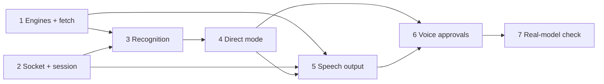

# M2 backend breakdown

Status: agreed. Date: 2026-10-22.

The backend half of M2: push-to-talk over `/api/voice`, direct mode, voice approvals and
spoken replies, as specified in [voice-protocol.md](voice-protocol.md). Each step below is
one commit with its own tests. The web client work (Q7, Q8, the layout) is tracked
separately.

## Shape

New code lives in two packages:

- `agent_talk/speech/` holds the models and nothing about sockets: VAD, the streaming
  transcriber, TTS, the text-for-speech cleaner, and the inference executor. It is
  ported from `spikes/speech/speech.py`, keeping the M0 decisions (int8 on CPU, fp32 on
  GPU, 4 threads, `HEURISTIC` conv search, full-pass finals).
- `agent_talk/voice/` holds the protocol: the `/api/voice` route, one `VoiceSession`
  per socket, frame encoding, generations, direct-mode dispatch and the approval flow.

The voice layer subscribes to the existing `EventBus` to learn when a task's turn
completes or an approval appears. `TaskManager` and `Approvals` need no new hooks;
`Approvals.decide` already takes `decided_by`, which becomes `"voice"`.

`create_app` takes a `speech` argument, as it takes `agents`. Tests pass fake engines
(fixed captions, a tone for TTS), just as `fake_codex.py` stands in for Codex. CI never
downloads models. Tests against real models are opt-in, behind a pytest marker.

Smart-turn is left out: push-to-talk ends turns on release. It comes back in M6, which
also drops its `transformers` dependency.

## Steps

### 1. Speech engines and model fetch

- Port `SileroVAD`, `Parakeet`, `StreamingTranscriber` and `TTS` into `agent_talk/speech/`
  behind small protocols (`Recognizer`, `Synthesizer`), with the fakes beside them.
- An inference executor: one worker thread per model, so inference never runs on the
  event loop. STT work is ordered final passes first, then captions (HLD §4.3).
- A `[speech]` config section: `device` (`auto`, `cpu`, `cuda`), `threads`, `voice`, and
  `enabled`.
- The speech part of a guided `agent-talk setup` (HLD §5.1, §9). It detects the CPU,
  RAM, GPU and free VRAM, recommends a tier and explains why ("RTX 4060, 7.1 GB free:
  GPU tier"), and lets the user accept or change it. If GPU is chosen, it reinstalls
  itself with the `cuda` extra through uv. It then downloads the pinned models into the
  data dir, checks their SHA-256, and runs a short self-test: it speaks a phrase,
  transcribes it back, and reports the timings. `--yes` accepts the recommendation
  without asking. M5 adds the service, Tailscale and llama-server steps to the same
  command.
- Engines load in the background at startup. The status feeds `ready.speech` in the
  protocol (`loading`, `ready`, `unavailable`), and the daemon starts and serves
  type-only use without them.

NOTICES and the README gain the speech dependencies, including the GPL-3 note and
Parakeet's CC-BY attribution.

Tests: the fakes satisfy the protocols, the executor orders work by priority, the fetch
command checks checksums (against a local file server), and the daemon starts with
models missing.

### 2. Voice socket and session

- `/api/voice` with the Origin check, `ready`, and the start/end/cancel/stop controls.
- Uplink frame validation (`bad_frame`), one open turn per session (`busy`), and the
  2 s uplink buffer that fails the turn with `uplink_behind`.
- `voice_state` changes, the generation counter (+1 on `start` and `stop` only),
  `stopped`, and downlink framing (the 8-byte header).
- Closing the socket discards the open turn and stops its speech.
- A plain full-pass final, and the basic direct-mode target (the selected task, else a
  new task in the project), so the socket works end to end from this step on.

Tests run with Starlette's `TestClient` WebSocket and fake engines, covering each rule in
voice-protocol §2–§7. The client's Q7 microphone work can connect from this step on.

### 3. Recognition

- VAD over the turn's audio; a turn with no speech ends with `final` `empty`.
- A caption tick every 250 ms while listening, sending only when the text changed. The
  interval stretches when decodes take longer than the tick.
- On `end`: `transcribing`, then the full-pass final.
- CPU only: segments that end at a VAD pause get their full pass in the background while
  the user keeps talking, so release only waits for the last segment (HLD §6.2).

Tests: fakes check the caption cadence and the adaptive interval, the empty turn, and
that incremental segments join into the same final. One opt-in test runs real Parakeet
on a LibriSpeech clip and checks the final text.

### 4. Direct mode dispatch

- The basic target arrives in step 2: `start.task_id` as a follow-up, else a new task in
  `start.project_id`, else `no_target`.
- Route a leading project name or alias set off by a comma or colon ("in backend, …")
  to that project, with the routing phrase removed. Matching is exact on normalised words in M2; fuzzy matching
  comes with the front assistant in M3.
- A transcript that is only "stop" stops speech; one that is only "cancel" cancels the
  target task. Neither is dispatched.
- Which session dispatched to which task is recorded from step 2 on (`VoiceHub.owner`).

Tests: each target rule, routing with and without a match, the stop and cancel words,
and `dispatch_failed` when `TaskManager` raises.

### 5. Speech output

- `for_speech(text)`: strip markdown, drop code blocks, inline code, URLs and paths, and
  put a short phrase where something was dropped ("I've left a code block in the
  timeline"). A pure function with table-driven tests over real Codex replies.
- A clause splitter with a short first chunk (HLD §6.4).
- The speaker: per session, it synthesizes one segment ahead, sends `speech` then the
  audio frames, awaits each send, and ends with `speech_end`. `voice_state` is
  `speaking` while frames are going out.
- When a task's turn completes, its last agent message from that turn is spoken on the
  session that dispatched it, and on no other. It is spoken in full; the front assistant
  summarises replies for speech in M3.
- Pressing talk interrupts speech at once (the generation rule in voice-protocol §7).

Tests: the cleaner and the splitter on fixtures; with fakes, that a reply reaches only
the owning session, that `stop` drops the rest of a generation, and that a second reply
queues behind the first in the same generation.

### 6. Voice approvals

- On an `approval` event with status `pending`, find the owning session and queue the
  approval there, oldest first. Ask it between turns only.
- The prompt: the task's name and the exact action, with commands read verbatim.
- While an approval is being asked, the session's next turn answers it:
  yes/approve, no/decline, always (only when the card would offer Always), or cancel.
  Anything else gets `reprompt`. A destructive request needs "confirm" after "yes".
- If the card answers first, the queued prompt is dropped, and stopped mid-speech if it
  is playing.

Tests: each answer, always refused where a rule can't be made, the confirm step, the
reprompt, the race with the card (`Approvals.decide` raising `LookupError` once the
other side has answered), and `decided_by: "voice"`.

### 7. Real-model check

An opt-in end-to-end run on CPU and GPU: a recorded command goes in over `/api/voice`
against the fake Codex, and the spoken reply comes back. Compare the timings with M0's
(end of speech to first reply audio: 0.3–0.45 s on GPU, about 1.3 s on CPU) and record
them in this doc.

## Order and parallel work

Step 1 and step 2 don't depend on each other, because step 2 runs on fakes. `for_speech`
and the clause splitter in step 5 are pure functions and can be written at any time.
After that: 3 needs 1 and 2; 4 needs 3; 5 needs 1 and 2 (the spoken-reply part needs 4);
6 needs 4 and 5; 7 comes last.

## Decisions

- Setup is guided, with a recommendation for each choice (step 1).
- Replies are spoken in full until M3's front assistant summarises them.
- Pressing talk is the only way to interrupt speech in M2. Interrupting by voice needs
  the mic open during playback and reliable echo cancellation, so it stays in M6.
- kokoro-onnx is dropped and the Kokoro ONNX model is called directly, so the base
  package has no onnxruntime dependency. `cpu` and `cuda` extras provide one (as
  onnx-asr's extras do), and setup installs the one it recommends.
- The GPL-3 phonemizer and espeak-ng are accepted in-process (option A below). NOTICES
  and the README say that the speech dependencies include GPL-3 components and that a
  bundle of them is GPL-3.

## Licensing of the speech stack

| Component | Licence | How it arrives |
| --- | --- | --- |
| Silero VAD v5 | MIT | model download |
| Parakeet TDT 0.6B v2 | CC-BY-4.0 (attribution) | model download |
| onnx-asr | MIT | pip |
| onnxruntime / onnxruntime-gpu | MIT | pip |
| NVIDIA CUDA and cuDNN wheels (`cuda` extra) | NVIDIA EULA (redistributable) | pip |
| Kokoro-82M weights and voices | Apache-2.0 | model download |
| kokoro-onnx | MIT | pip |
| phonemizer | **GPL-3.0-or-later** | pip, imported into the daemon |
| espeakng-loader | wheel bundles `libespeak-ng.so` (**GPL-3.0**) | pip, loaded into the daemon |
| misaki (Kokoro's own G2P) | Apache-2.0 core; its `en` extra pulls phonemizer-fork and espeakng-loader | pip |

Kokoro turns text into phonemes before synthesis. kokoro-onnx does that with
phonemizer, which drives espeak-ng, and both are GPL. They load into the daemon's own
process, which under the FSF's reading makes the running program a combined work under
GPL-3. Agent Talk's own code stays Apache-2.0, and nothing is owed while each user
installs the parts on their own machine. The GPL applies when someone conveys the
combination: a Docker image, a distro or Homebrew package with dependencies, or a
frozen binary would have to be offered under GPL-3. It also misses the goal in HLD §12
of a permissive dependency set. This is a summary, not legal advice.

Options:

- **A. Accept it.** Keep espeak-ng in-process and say in NOTICES and the README that the
  speech extra brings in GPL-3 components. No work. Packagers inherit GPL-3.
- **B. Keep espeak-ng, in a separate process.** A small helper phonemizes over
  stdin/stdout. Communicating at arm's length between separate programs is the usual
  line in the GPL FAQ, so the daemon stays a separate work. The helper and espeak-ng
  are still installed, and still GPL. A day or two of work, with negligible latency
  from a persistent process.
- **C. Remove espeak-ng.** Use misaki's core (Apache-2.0) with its English dictionaries
  and spaCy (MIT), without the `en` extra and its espeak fallback. Kokoro was trained on
  misaki's phonemes, so known words sound the same or better. Words missing from the
  dictionaries (names, identifiers) need a fallback of our own, such as spelling them
  out. This is the most work, adds spaCy and its small English model (tens of MB), and
  pronounces unusual words worse.

Chosen: A. B and C remain open if a packager or contributor needs a GPL-free build.
Piper, the low-end fallback, depends on espeak-ng too, so the same choice covers it.

Unrelated to the GPL: Parakeet's CC-BY-4.0 needs attribution in NOTICES and in the app,
as HLD §5.1 already says.
